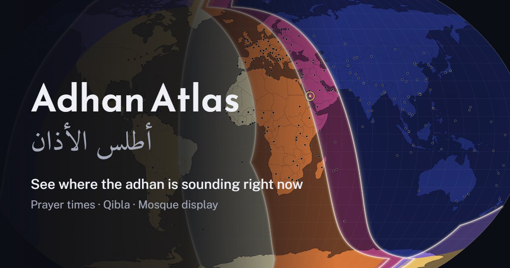

<div align="center">


# Adhan Atlas

**A live world map of the five daily prayers.**
See where the adhan is sounding right now, anywhere on Earth.

### [Open the app → athanatlas.netlify.app](https://athanatlas.netlify.app)

Free · English and Arabic · No accounts, ads or tracking

</div>



## What it does

- **Live globe and map.** The world is shaded by the current prayer period, with bright lines where each prayer is
  beginning.
- **Prayer times for any place.** Tap the map or search for a town. The calculation method follows the country, and
  you can change it.
- **Qibla.** The direction from any place, with a compass on phones.
- **Timetable.** A month of times you can print or add to your calendar.
- **Islamic dates.** The Hijri date and the days until Ramadan, the two Eids and the other dates of the year.
- **New crescent.** A map of where the new moon can be seen each month.
- **Mosque display.** A full-screen clock with prayer and iqamah times for a wall screen.
- **City pages.** A plain page of times for about 770 cities, in
  [English](https://athanatlas.netlify.app/prayer-times/) and [Arabic](https://athanatlas.netlify.app/ar/prayer-times/).

Everything is calculated on your own device from the position of the sun, so it works with no connection once it has
been opened.

## Install it

Adhan Atlas is a web app. There is nothing to download from a store: open
[athanatlas.netlify.app](https://athanatlas.netlify.app) and add it to your device. It then opens in its own window
with its own icon, and works offline.

| Device | Browser | Steps |
|---|---|---|
| **Windows, Mac, Linux** | Chrome or Edge | Open the site, then click the install icon at the right of the address bar, or open the **⋮** menu and choose **Install Adhan Atlas** (Edge: **Apps → Install this site as an app**). |
| **Mac** | Safari | Open the site, then choose **File → Add to Dock**. |
| **Android** | Chrome | Open the site, tap **⋮**, then **Add to Home screen → Install**. |
| **iPhone, iPad** | Safari | Open the site, tap **Share**, then **Add to Home Screen**. |

To remove it, uninstall it like any other app. Nothing else is left on the device.

## Build it yourself

Needs [Node.js](https://nodejs.org/) 18 or later, and nothing else.

```bash
git clone https://github.com/modonassef/adhan-atlas.git
cd adhan-atlas
node src/build.js site               # the website, into site/
node src/build.js adhan-atlas.html   # the same app as one self-contained file
```

Upload the `site` folder to any static host. To try it on your own computer first:

```bash
python -m http.server 8767 --directory site
```

then open <http://localhost:8767>.

## What is where

| Path | What it is |
|---|---|
| `src/template.html` | The app: page, styles and script |
| `src/core.js` | The prayer-time astronomy |
| `src/citypages.js` | Makes the website's page for each city, in English and Arabic |
| `src/data/` | Towns, time zones and country outlines |
| `src/web/` | Files copied into the website as they are: fonts, icons, the offline worker |

## Credits

- Town names, positions and time zones: [GeoNames](https://www.geonames.org/) (CC BY 4.0)
- Country outlines and populations: [Natural Earth](https://www.naturalearthdata.com/) (public domain)
- Airports: [OurAirports](https://ourairports.com/) (public domain)
- Prayer-time calculation after [PrayTimes.org](http://praytimes.org/)
- Map drawing: [D3](https://d3js.org/) and topojson-client (ISC)
- Fonts, under the SIL Open Font License 1.1: Reem Kufi, Amiri Quran, Public Sans, IBM Plex Mono and IBM Plex Sans
  Arabic

The full list is on the site's [Privacy and credits](https://athanatlas.netlify.app/about.html) page.

## Licence

The code is under the [MIT License](LICENSE). The map data, fonts and libraries keep their own licences, credited above.
